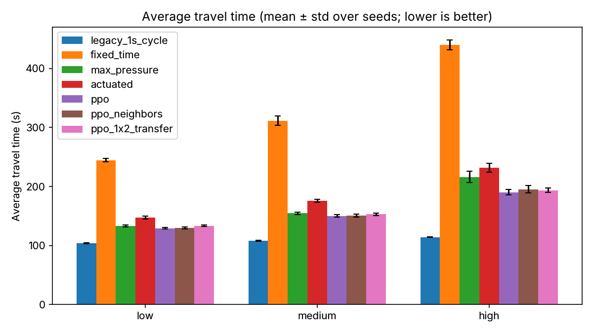

# Traffic Signal Control with Reinforcement Learning

## Overview
This project uses Reinforcement Learning (RL) to control traffic signals in the CityFlow traffic simulator.

**Headline result:** under realistic signal timing (at least 10 s of green and a 5 s clearance on every change), a PPO agent cuts average travel time by 15% compared with detector-based actuated control, which is how most real signals adapt, and by 74% compared with a fixed timer, in heavy traffic on the two-intersection network. On a 16-intersection grid with rush-hour traffic, PPO is again the fastest controller, 12% ahead of max-pressure and 18% ahead of actuated control in heavy traffic. All results are measured on traffic the agent never saw during training.

**The catch:** the agents' average is better, but their worst case is not. With no limit on how long a red can last, PPO sometimes leaves a single car stopped for 6-7 minutes, while actuated control never holds one for more than about 2 minutes. See [Worst-case waits](#worst-case-waits).

## Features
- **Multi-agent RL environment** for CityFlow with realistic signal timing (`scripts/signal_env.py`)
- **PPO and DQN agents** (RLlib) sharing one policy across intersections
- **Realistic baselines**: fixed-time, detector-based actuated control and max-pressure
- **Randomized, seeded traffic scenarios**, with separate seeds for training and evaluation
- **Two networks**: a two-intersection corridor and a 4x4 grid with arterials and a rush-hour peak
- **Evaluation on traffic outcomes**: travel time, queue length, throughput, completion rate and worst-case waits
- Dockerfile, pinned dependencies and tests

## Project Structure
```
├── configs/           # Simulation and network configuration files (grid4x4/ is the 4x4 grid)
├── docs/              # Report and presentation slides (PDF)
├── data/              # Collected rewards and results (e.g., fixed_rewards.csv)
├── frontend/          # Visualization and replay tools
├── logs/              # Training and evaluation logs
├── models/            # Saved RL models
├── notebooks/         # Jupyter notebook for experiments and analysis
├── results/           # Evaluation outputs (scripts/evaluate.py)
├── scripts/           # Core RL and simulation scripts
│   ├── evaluate.py    # Compare controllers on travel time, queues, throughput
│   ├── controllers.py # Baselines: fixed-time, actuated, max-pressure, legacy
│   ├── signal_env.py  # RL environment with min green / clearance rules
│   ├── train_ppo.py   # Train PPO (shared policy) on randomized traffic
│   ├── train_dqn.py   # Train DQN with the same setup
│   ├── plot_training.py # Training curves
│   ├── scenarios.py   # Randomized low/medium/high demand scenarios for both networks
│   ├── ppo.py         # PPO RL agent implementation
│   ├── traffic_env.py # Environment wrapper for CityFlow
│   ├── traffic_env_ppo.py # Policy evaluation and utility functions
│   └── results/       # Graphs and training logs
└── requirements.txt   # Python dependencies
```

## Getting Started
### Prerequisites
- Python 3.10 (Ray 2.39 and the CityFlow build are tested against it)
- A C++ toolchain and CMake, to build [CityFlow](https://cityflow-project.github.io/) (it is not on PyPI)

### Installation
**Option A: Docker (recommended).** Builds CityFlow and all dependencies in one step:
```bash
docker build -t traffic-rl .
docker run --rm traffic-rl            # runs the smoke test
docker run --rm -it traffic-rl bash   # interactive shell
```

**Option B: local virtual environment.**
```bash
git clone <repo_url>
cd Traffic-Signal-Control-RL
python3.10 -m venv venv && source venv/bin/activate
pip install "git+https://github.com/cityflow-project/CityFlow.git@81ee0f47659ca66177a71f81676691c58ee89184"
pip install -r requirements.txt
pytest -q tests                        # ~3 s; run it while no training is using the CPU (CityFlow slows to a crawl when cores are oversubscribed)
```
Scripts resolve config, data, log and model paths from the repository root, so they can be run from any directory.

### Running Experiments
#### 1. Baseline: Fixed Signal Control
```bash
python scripts/traffic_env.py
```
or from Python:
```python
from traffic_env import TrafficSignalEnv, fixed_signal_control
env = TrafficSignalEnv(max_steps=1000)
fixed_rewards = fixed_signal_control(env)
```

#### 2. RL Agents: PPO and DQN with realistic signal timing
```bash
python scripts/train_ppo.py --iterations 250            # ~25 min on 4 CPU cores; writes models/ppo_timed
python scripts/train_dqn.py --timesteps 600000          # ~45 min; writes models/dqn_timed
python scripts/evaluate.py --policy ppo=models/ppo_timed dqn=models/dqn_timed
python scripts/plot_training.py                         # results/training_curves.png
```
Agents train in `TimedSignalEnv` (`scripts/signal_env.py`), which holds them to the same rules as the baselines:
- a decision every 5 s, choosing which green phase to show,
- at least 10 s of green before a change (earlier requests are ignored; the observation says whether switching is allowed),
- a 5 s clearance (phase 0) on every change.

Observations per intersection: vehicle and waiting counts on each incoming lane, the current phase, and "can switch" / "in clearance" flags. The default reward is minus the number of waiting vehicles on the intersection's incoming lanes (`--reward pressure` and `--reward legacy` are also available). Both intersections share one policy (independent PPO with parameter sharing; there is no centralized critic). Every training episode draws a new random scenario (low, medium or high demand, seeds 1000-1049), so the evaluation seeds (0-4) are never seen during training.

Trained checkpoints are committed with their `training_log.csv`: `models/ppo_timed` (PPO, queue reward), `models/ppo_pressure` (PPO, pressure reward) and `models/dqn_timed` (DQN with double Q-learning, a dueling network, 3-step returns and prioritized replay).

An older pipeline (`scripts/traffic_env_ppo.py`, which lets agents switch every second) and its old checkpoint `models/ppo_trained_model` are kept for reference only. That checkpoint was trained with agents on the six virtual intersections and no longer loads. `scripts/ppo.py` is a single-agent CleanRL PPO reference implementation and is not wired to this environment.

#### 3. Evaluate controllers on traffic outcomes
```bash
python scripts/evaluate.py                                   # all baselines, low/medium/high/original, 5 seeds, 1 h episodes
python scripts/evaluate.py --scenarios medium --seeds 0 1 --horizon 600
python scripts/evaluate.py --policy ppo=models/ppo_timed            # add a trained policy (":sample" suffix samples actions)
```
This runs each controller on randomized traffic scenarios (`scripts/scenarios.py`: Poisson arrivals with turning traffic at low, medium and high demand, plus the original flow file) and reports average travel time, average queue length, throughput and completion rate as mean ± std over seeds. Results go to `results/evaluation/` (`summary.md`, `summary.csv`, `runs.csv`, `travel_time.png`).

Baselines (`scripts/controllers.py`):
- `fixed_time`: pre-timed 4-phase plan, 30 s green per phase with a 5 s clearance between phases
- `max_pressure`: max-pressure control (a research benchmark), re-decided every 10 s (minimum green) with a 5 s clearance on every change
- `actuated`: fully actuated control, the way most detector-equipped signals in the field run (see below)
- `legacy_1s_cycle`: an older baseline that changes phase every second (kept for reference only; see below)

**How real signals adapt.** Real signals don't weigh cars (pressure plates are a myth). Most sense them with inductive loops cut into the pavement near the stop line, or with video or radar zones that act like loops ([Wikipedia: Signal timing](https://en.wikipedia.org/wiki/Signal_timing)). Under actuated control ([FHWA Traffic Signal Timing Manual, ch. 5](https://ops-dr.fhwa.dot.gov/Publications/signal_timing/04.htm)):
- each green gets a minimum time (typically 5-10 s),
- each detected vehicle extends the green until no vehicle has crossed the detector for a "passage time" (gap-out),
- a maximum green ends it if another phase is waiting (max-out),
- phases with no waiting vehicles are skipped.

The `actuated` baseline models this with a stop-line detector covering the last 30 m of each lane, a 10 s minimum green, 3 s passage time, 40 s maximum green and 5 s clearance. Its results barely changed across passage times of 2-3 s and maximum greens of 40-60 s.

#### 4. The 4x4 grid
```bash
python scripts/train_ppo.py --network 4x4 --iterations 250 --batch-size 16000 --count-steps-by agent_steps --out models/ppo_grid4x4
python scripts/train_ppo.py --network 4x4 --iterations 250 --batch-size 16000 --count-steps-by agent_steps --neighbors --out models/ppo_grid4x4_neighbors
python scripts/evaluate.py --network 4x4 --policy ppo=models/ppo_grid4x4 ppo_neighbors=models/ppo_grid4x4_neighbors ppo_1x2_transfer=models/ppo_timed
```
Each training run takes about 28 minutes on 4 CPU cores. Results go to `results/evaluation_4x4/`. The grid (`configs/grid4x4/`, built with CityFlow's `generate_grid_scenario.py`) has 16 signalised intersections, 300 m roads and 3 lanes per approach. Its traffic is harder than the corridor's:
- the two middle east-west roads are arterials with twice the demand of the other entry roads,
- demand follows a one-hour rush hour, rising from 60% of the average to 140% at the peak and back,
- vehicles may turn at every intersection, so most trips cross several signals.

`--neighbors` adds the waiting counts on the adjacent intersections' incoming roads to each agent's observation.

#### 5. Visualize Results
Use the notebook or `scripts/results/create_graph.py` to visualize reward curves:
```bash
python scripts/results/create_graph.py
```
This generates `rewards.png` comparing mean rewards over training iterations.

## Configuration
- Edit files in `configs/training/` and `configs/evaluation/` to modify the road network, flow, and simulation parameters.
- Example config: `configs/training/training_config.json`

## Results

### How results are measured
Every controller is judged on what drivers experience, not on the RL reward:
- **Average travel time**: the main metric. It covers every vehicle that entered the network, and vehicles still driving at the end count up to the end of the episode.
- **Average queue**: waiting vehicles per intersection, sampled every second.
- **Throughput and completion rate**: trips finished, and finished trips as a share of vehicles that entered.
- **Worst-case waits**: for each vehicle, the total time it spent stopped and its longest single stop. We report the 95th percentile and the maximum over all vehicles in an episode. An average can hide a few cars that are kept at a red for minutes, and these metrics catch that.

Each number is the mean ± standard deviation over 5 one-hour episodes with different random traffic (seeds 0-4). Agents are trained on seeds 1000-1049, so these are always unseen traffic. Run `python scripts/evaluate.py --policy ppo=models/ppo_timed dqn=models/dqn_timed ppo_pressure=models/ppo_pressure` to reproduce.

### Findings: two-intersection corridor
Average travel time in seconds (lower is better):

| Controller | Low demand | Medium demand | High demand |
|---|---|---|---|
| Fixed-time (30 s greens) | 93.7 ± 2.4 | 119.6 ± 9.0 | 314.5 ± 15.3 |
| Actuated (detector-based, like real signals) | 64.5 ± 0.9 | 77.7 ± 0.9 | 96.0 ± 3.9 |
| Max-pressure (research benchmark) | 61.5 ± 0.3 | 70.2 ± 0.9 | 112.5 ± 6.1 |
| **PPO** | **60.2 ± 0.6** | **67.5 ± 0.5** | **81.3 ± 1.5** |
| DQN | 60.6 ± 0.7 | 68.1 ± 0.4 | 86.3 ± 2.6 |


1. **The RL agents beat every realistic controller, and the gap grows with traffic.** In heavy traffic PPO's average trip takes 81 s, against 96 s for actuated control (15% faster) and 315 s for the fixed timer (74% faster). Queues are about a third shorter than under actuated control (12.9 vs 19.8 waiting vehicles per intersection). In light traffic every adaptive controller is within a few seconds of the others, so RL adds little there.
2. **The real competitor is actuated control, not a fixed timer.** Simply reacting to detected cars cuts travel time by 31-69% compared with the fixed timer. Most of what a "PPO beats fixed timing" comparison shows is the value of adapting at all; the RL-specific gain is a further 7-15% over actuated control.
3. **The result is robust.** A second PPO training run reproduced the numbers to within 0.2 s. DQN reaches nearly the same performance, and PPO is ahead only in heavy traffic (81 s vs 86 s).
4. **The environment mattered more than the algorithm.** PPO only beat the baselines once agents were held to realistic timing rules and RLlib's value-function clipping was fixed (the default `vf_clip_param=10` stopped the first run from learning; it did worse than the fixed timer).

The full table, which also covers queue length, throughput, the pressure-reward agent and the original traffic file, is in [`results/evaluation/summary.md`](results/evaluation/summary.md).

### Findings: 4x4 grid
Average travel time in seconds (lower is better):

| Controller | Low demand | Medium demand | High demand |
|---|---|---|---|
| Fixed-time (30 s greens) | 244.3 ± 2.9 | 311.4 ± 8.0 | 439.4 ± 8.4 |
| Actuated | 147.2 ± 2.7 | 175.6 ± 2.7 | 231.7 ± 7.7 |
| Max-pressure | 133.1 ± 1.8 | 154.5 ± 1.9 | 216.1 ± 9.5 |
| **PPO** | **129.3 ± 1.6** | **150.2 ± 2.0** | **190.3 ± 4.3** |
| PPO with neighbour observations | 130.0 ± 1.6 | 150.5 ± 2.5 | 195.3 ± 5.9 |
| PPO trained on the corridor, unchanged | 133.3 ± 1.4 | 153.0 ± 2.0 | 193.6 ± 3.7 |



1. **PPO is still the fastest controller, and again the lead grows with traffic.** In heavy traffic its average trip takes 190 s, against 216 s for max-pressure (12% faster) and 232 s for actuated control (18% faster). It also has the shortest queues (8.3 waiting vehicles per intersection, vs 11.0 and 12.2) and the highest completion rate.
2. **On the grid, max-pressure beats actuated control.** On the corridor it was the other way round in heavy traffic. Max-pressure looks at downstream roads as well as its own queues, which matters more when vehicles cross several signals and queues can spill back.
3. **Seeing the neighbours didn't help.** Adding the adjacent intersections' queues to the observation gave the same results at low and medium demand and was slightly worse at high demand (195 s vs 190 s). Each agent's own queues seem to carry most of the useful information, at least for a policy without explicit coordination.
4. **The corridor policy transfers.** The agent trained only on the two-intersection corridor, run unchanged on all 16 grid intersections, is within 2-3% of the agent trained on the grid. It beats actuated control at every demand level and matches or beats max-pressure. Because one policy is shared by every intersection, it only has to learn how to run one junction.

The full tables are in [`results/evaluation_4x4/summary.md`](results/evaluation_4x4/summary.md).

### Worst-case waits
A controller can keep the average low by holding a quiet approach at red while it serves the busy ones, so a few unlucky drivers wait far longer than anyone would accept. Here is how long the worst-treated vehicles were stopped in heavy traffic, in seconds (mean ± std over the 5 seeds of each episode's value):

| Network | Controller | 95th pct. time stopped | Max time stopped | Longest single stop |
|---|---|---|---|---|
| Corridor | Actuated | 116 ± 17 | **186 ± 21** | **111 ± 4** |
| Corridor | Max-pressure | 250 ± 24 | 674 ± 52 | 526 ± 102 |
| Corridor | PPO | **100 ± 11** | 420 ± 47 | 365 ± 61 |
| Corridor | DQN | 104 ± 10 | 627 ± 116 | 484 ± 113 |
| 4x4 grid | Actuated | 272 ± 12 | **616 ± 70** | **117 ± 4** |
| 4x4 grid | Max-pressure | 340 ± 40 | 1304 ± 215 | 632 ± 76 |
| 4x4 grid | PPO | **222 ± 16** | 734 ± 118 | 413 ± 39 |

1. **The RL agents serve 95% of drivers best, but starve a few.** PPO has the lowest 95th-percentile stopped time on both networks. Its worst single stop, though, is 365 s on the corridor and 413 s on the grid, about 6-7 minutes at one red light. The same happens at medium demand (267 s and 324 s).
2. **Actuated control has the best worst case.** Its maximum green ends every phase within 40 s once another approach is waiting, so no car waits much more than one full cycle: about 2 minutes at most. Fixed-time is bounded the same way. Max-pressure has no such limit and has the longest single stops of any controller.
3. **Nothing in the agents' training rules this out.** The queue reward counts waiting cars, not how long each has waited, so leaving one car at a red costs the agent very little. Real signal controllers always enforce a maximum red. The natural next step is to add one to `TimedSignalEnv` (or a reward penalty that grows with waiting time) and measure what it costs in average travel time.

Both `summary.md` files also list the 95th-percentile and longest trip times for every controller and demand level. On the original traffic file the trip-time columns only cover the few vehicles that finished, so they aren't comparable across controllers.

## References
- [CityFlow: An Open-source Traffic Simulator](https://cityflow-project.github.io/)
- RL Algorithm: PPO ([Schulman et al., 2017](https://arxiv.org/abs/1707.06347))

## Acknowledgements
- This project uses CityFlow for traffic simulation and builds on open-source RL libraries.

## License
MIT License

---

For questions or contributions, please open an issue or pull request.
