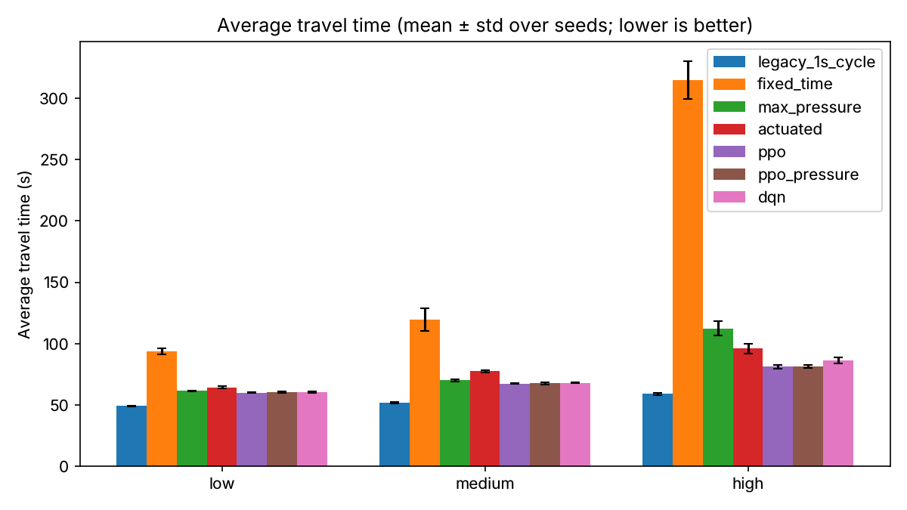

# Traffic Signal Control with Reinforcement Learning

## Overview
This project explores the application of Reinforcement Learning (RL) to optimize traffic signal control in urban road networks. By leveraging the CityFlow traffic simulator, the system aims to reduce congestion and improve traffic flow by dynamically adjusting traffic lights based on real-time traffic conditions.

The project provides a comparison between a rule-based fixed signal control baseline and a Proximal Policy Optimization (PPO) RL agent.

## Features
- **Multi-agent RL environment** for traffic signal control using CityFlow
- **PPO (Proximal Policy Optimization)** implementation for learning optimal traffic light policies
- **Baseline fixed-signal control** for benchmarking
- **Configurable simulation scenarios** via JSON files
- **Training, evaluation, and visualization tools**

## Project Structure
```
├── configs/           # Simulation and network configuration files
├── docs/              # Class report and slides, plus REPORT.md (this follow-up)
├── data/              # Collected rewards and results (e.g., fixed_rewards.csv)
├── frontend/          # Visualization and replay tools
├── logs/              # Training and evaluation logs
├── models/            # Saved RL models
├── notebooks/         # Jupyter notebook for experiments and analysis
├── results/           # Evaluation outputs (scripts/evaluate.py)
├── scripts/           # Core RL and simulation scripts
│   ├── evaluate.py    # Compare controllers on travel time, queues, throughput
│   ├── controllers.py # Baselines: fixed-time, actuated, max-pressure, legacy
│   ├── signal_env.py  # RL environment with min green / clearance rules
│   ├── train_ppo.py   # Train PPO (shared policy) on randomized traffic
│   ├── train_dqn.py   # Train DQN with the same setup
│   ├── plot_training.py # Training curves
│   ├── scenarios.py   # Randomized low/medium/high demand scenarios
│   ├── ppo.py         # PPO RL agent implementation
│   ├── traffic_env.py # Environment wrapper for CityFlow
│   ├── traffic_env_ppo.py # Policy evaluation and utility functions
│   └── results/       # Graphs and training logs
└── requirements.txt   # Python dependencies
```

## Getting Started
### Prerequisites
- Python 3.10 (Ray 2.39 and the CityFlow build are tested against it)
- A C++ toolchain and CMake, to build [CityFlow](https://cityflow-project.github.io/) (it is not on PyPI)

### Installation
**Option A: Docker (recommended).** Builds CityFlow and all dependencies in one step:
```bash
docker build -t traffic-rl .
docker run --rm traffic-rl            # runs the smoke test
docker run --rm -it traffic-rl bash   # interactive shell
```

**Option B: local virtual environment.**
```bash
git clone <repo_url>
cd Traffic-Signal-Control-RL
python3.10 -m venv venv && source venv/bin/activate
pip install "git+https://github.com/cityflow-project/CityFlow.git@81ee0f47659ca66177a71f81676691c58ee89184"
pip install -r requirements.txt
pytest -q tests                        # ~3 s; run it while no training is using the CPU (CityFlow slows to a crawl when cores are oversubscribed)
```
`requirements-freeze-2024.txt` is the original full `pip freeze` from the class project, kept for reference.

Scripts resolve config, data, log and model paths from the repository root, so they can be run from any directory.

### Running Experiments
#### 1. Baseline: Fixed Signal Control
```bash
python scripts/traffic_env.py
```
or from Python:
```python
from traffic_env import TrafficSignalEnv, fixed_signal_control
env = TrafficSignalEnv(max_steps=1000)
fixed_rewards = fixed_signal_control(env)
```

#### 2. RL Agents: PPO and DQN with realistic signal timing
```bash
python scripts/train_ppo.py --iterations 250            # ~25 min on 4 CPU cores; writes models/ppo_timed
python scripts/train_dqn.py --timesteps 600000          # ~45 min; writes models/dqn_timed
python scripts/evaluate.py --policy ppo=models/ppo_timed dqn=models/dqn_timed
python scripts/plot_training.py                         # results/training_curves.png
```
Agents train in `TimedSignalEnv` (`scripts/signal_env.py`), which holds them to the same rules as the baselines:
- a decision every 5 s, choosing which green phase to show,
- at least 10 s of green before a change (earlier requests are ignored; the observation says whether switching is allowed),
- a 5 s clearance (phase 0) on every change.

Observations per intersection: vehicle and waiting counts on each incoming lane, the current phase, and "can switch" / "in clearance" flags. The default reward is minus the number of waiting vehicles on the intersection's incoming lanes (`--reward pressure` and `--reward legacy` are also available). Both intersections share one policy (independent PPO with parameter sharing; there is no centralized critic). Every training episode draws a new random scenario (low, medium or high demand, seeds 1000-1049), so the evaluation seeds (0-4) are never seen during training.

Trained checkpoints are committed with their `training_log.csv`: `models/ppo_timed` (PPO, queue reward), `models/ppo_pressure` (PPO, pressure reward) and `models/dqn_timed` (DQN with double Q-learning, a dueling network, 3-step returns and prioritized replay).

The original class pipeline (`scripts/traffic_env_ppo.py`, which lets agents switch every second) and its old checkpoint `models/ppo_trained_model` are kept for reference only. That checkpoint was trained with agents on the six virtual intersections and no longer loads. `scripts/ppo.py` is a single-agent CleanRL PPO reference implementation and is not wired to this environment.

#### 3. Evaluate controllers on traffic outcomes
```bash
python scripts/evaluate.py                                   # all baselines, low/medium/high/original, 5 seeds, 1 h episodes
python scripts/evaluate.py --scenarios medium --seeds 0 1 --horizon 600
python scripts/evaluate.py --policy ppo=models/ppo_timed            # add a trained policy (":sample" suffix samples actions)
```
This runs each controller on randomized traffic scenarios (`scripts/scenarios.py`: Poisson arrivals with turning traffic at low, medium and high demand, plus the original flow file) and reports average travel time, average queue length, throughput and completion rate as mean ± std over seeds. Results go to `results/evaluation/` (`summary.md`, `summary.csv`, `runs.csv`, `travel_time.png`).

Baselines (`scripts/controllers.py`):
- `fixed_time`: pre-timed 4-phase plan, 30 s green per phase with a 5 s clearance between phases
- `max_pressure`: max-pressure control (a research benchmark), re-decided every 10 s (minimum green) with a 5 s clearance on every change
- `actuated`: fully actuated control, the way most detector-equipped signals in the field run (see below)
- `legacy_1s_cycle`: the class project's original baseline, which changes phase every second (kept for reference only; see below)

**How real signals adapt.** Real signals don't weigh cars (pressure plates are a myth). Most sense them with inductive loops cut into the pavement near the stop line, or with video or radar zones that act like loops ([Wikipedia: Signal timing](https://en.wikipedia.org/wiki/Signal_timing)). Under actuated control ([FHWA Traffic Signal Timing Manual, ch. 5](https://ops-dr.fhwa.dot.gov/Publications/signal_timing/04.htm)):
- each green gets a minimum time (typically 5-10 s),
- each detected vehicle extends the green until no vehicle has crossed the detector for a "passage time" (gap-out),
- a maximum green ends it if another phase is waiting (max-out),
- phases with no waiting vehicles are skipped.

The `actuated` baseline models this with a stop-line detector covering the last 30 m of each lane, a 10 s minimum green, 3 s passage time, 40 s maximum green and 5 s clearance. Its results barely changed across passage times of 2-3 s and maximum greens of 40-60 s.

#### 4. Visualize Results
Use the notebook or `scripts/results/create_graph.py` to visualize reward curves:
```bash
python scripts/results/create_graph.py
```
This generates `rewards.png` comparing mean rewards over training iterations.

## Configuration
- Edit files in `configs/training/` and `configs/evaluation/` to modify the road network, flow, and simulation parameters.
- Example config: `configs/training/training_config.json`

## Results
### Evaluation
**The full write-up is in [docs/REPORT.md](docs/REPORT.md).** It covers what was wrong with the original setup, the methods, the findings and the limitations.

Results of `python scripts/evaluate.py --policy ppo=models/ppo_timed ppo_pressure=models/ppo_pressure dqn=models/dqn_timed`: averages over 5 evaluation seeds of 1-hour episodes on the 2-intersection network. No agent saw these seeds in training. The original flow file is deterministic, so it runs once.

| Scenario | Controller | Avg travel time (s) | Avg queue (veh) | Throughput (veh) | Completed | Episodes |
|---|---|---|---|---|---|---|
| low | legacy_1s_cycle | 49.3 ± 0.3 | 0.03 ± 0.00 | 1067 ± 19 | 98.7% | 5 |
| low | fixed_time | 93.7 ± 2.4 | 6.44 ± 0.29 | 1062 ± 20 | 98.2% | 5 |
| low | max_pressure | 61.5 ± 0.3 | 1.64 ± 0.03 | 1065 ± 19 | 98.4% | 5 |
| low | actuated | 64.5 ± 0.9 | 1.90 ± 0.10 | 1064 ± 19 | 98.3% | 5 |
| low | ppo | 60.2 ± 0.6 | 1.43 ± 0.05 | 1066 ± 19 | 98.5% | 5 |
| low | ppo_pressure | 60.4 ± 0.5 | 1.49 ± 0.07 | 1064 ± 18 | 98.4% | 5 |
| low | dqn | 60.6 ± 0.7 | 1.46 ± 0.05 | 1065 ± 18 | 98.4% | 5 |
| medium | legacy_1s_cycle | 52.0 ± 0.4 | 0.07 ± 0.01 | 2160 ± 27 | 98.6% | 5 |
| medium | fixed_time | 119.6 ± 9.0 | 20.31 ± 2.49 | 2120 ± 18 | 96.8% | 5 |
| medium | max_pressure | 70.2 ± 0.9 | 5.51 ± 0.24 | 2146 ± 22 | 97.9% | 5 |
| medium | actuated | 77.7 ± 0.9 | 7.78 ± 0.26 | 2144 ± 25 | 97.9% | 5 |
| medium | ppo | 67.5 ± 0.5 | 4.78 ± 0.10 | 2151 ± 26 | 98.2% | 5 |
| medium | ppo_pressure | 67.7 ± 0.8 | 4.90 ± 0.19 | 2148 ± 25 | 98.1% | 5 |
| medium | dqn | 68.1 ± 0.4 | 4.85 ± 0.12 | 2148 ± 25 | 98.1% | 5 |
| high | legacy_1s_cycle | 59.1 ± 0.8 | 0.58 ± 0.08 | 3231 ± 45 | 98.3% | 5 |
| high | fixed_time | 314.5 ± 15.3 | 70.83 ± 3.06 | 2784 ± 39 | 92.6% | 5 |
| high | max_pressure | 112.5 ± 6.1 | 25.64 ± 2.72 | 3160 ± 44 | 96.1% | 5 |
| high | actuated | 96.0 ± 3.9 | 19.79 ± 1.81 | 3191 ± 43 | 97.1% | 5 |
| high | ppo | 81.3 ± 1.5 | 12.93 ± 0.65 | 3204 ± 44 | 97.5% | 5 |
| high | ppo_pressure | 81.5 ± 1.1 | 13.14 ± 0.46 | 3204 ± 44 | 97.5% | 5 |
| high | dqn | 86.3 ± 2.6 | 14.97 ± 1.18 | 3194 ± 43 | 97.2% | 5 |
| original | legacy_1s_cycle | 1344.6 ± 0.0 | 59.97 ± 0.00 | 2754 ± 0 | 91.9% | 1 |
| original | fixed_time | 1426.3 ± 0.0 | 83.32 ± 0.00 | 2300 ± 0 | 92.4% | 1 |
| original | max_pressure | 1072.3 ± 0.0 | 48.48 ± 0.00 | 4444 ± 0 | 96.1% | 1 |
| original | actuated | 1026.7 ± 0.0 | 51.27 ± 0.00 | 4722 ± 0 | 96.4% | 1 |
| original | ppo | 938.3 ± 0.0 | 43.54 ± 0.00 | 5235 ± 0 | 97.1% | 1 |
| original | ppo_pressure | 1263.5 ± 0.0 | 72.67 ± 0.00 | 3127 ± 0 | 93.9% | 1 |
| original | dqn | 1018.0 ± 0.0 | 35.34 ± 0.00 | 4748 ± 0 | 97.5% | 1 |



Takeaways:
- **RL beats every realistic controller at every demand level.** At high demand, PPO's average travel time is 81 s, against 96 s for actuated control and 113 s for max-pressure. At low demand all the adaptive controllers are within a few seconds of each other. A second PPO training seed reproduced the results to within 0.2 s.
- **Actuated (detector-based) control is the realistic baseline to beat.** It cuts travel time by 31-69% compared with the fixed timer.
- **PPO and DQN end up close.** PPO is ahead at high demand and learns faster. The queue and pressure rewards perform the same on the training distribution, but only the queue reward holds up on the original flow file, which is out of distribution.
- **The "change phase every second" legacy baseline exploits a simulator gap.** CityFlow has no yellow time or start-up loss. Real signals can't do this, so every other controller, the RL agents included, follows a 10 s minimum green and a 5 s clearance.

### Class project results (reward-based, superseded)
These compare the environment's own reward rather than traffic outcomes. They were produced with agents on the 6 light-less intersections and a phase-every-second baseline, so they aren't comparable with the table above.

#### Baseline (Fixed Signal Control)
- **Total reward** (sample run): ~992.33
- Reward increases steadily with simulation steps, reaching ~885 at step 893 (see `data/fixed_rewards.csv`).

#### PPO RL Agent
- **Mean reward** improves over training:
    - Iteration 1: 1014.80
    - Iteration 10: 1205.67
    - Iteration 20: 1241.89
    - Iteration 30: 1270.44
    - Iteration 40: 1293.09
    - Iteration 46: 1311.09
- PPO outperforms the fixed-signal baseline, as shown in `scripts/results/rewards.png`.


## References
- [CityFlow: An Open-source Traffic Simulator](https://cityflow-project.github.io/)
- RL Algorithm: PPO ([Schulman et al., 2017](https://arxiv.org/abs/1707.06347))

## Acknowledgements
- This project uses CityFlow for traffic simulation and builds on open-source RL libraries.

## License
MIT License

---

For questions or contributions, please open an issue or pull request.
