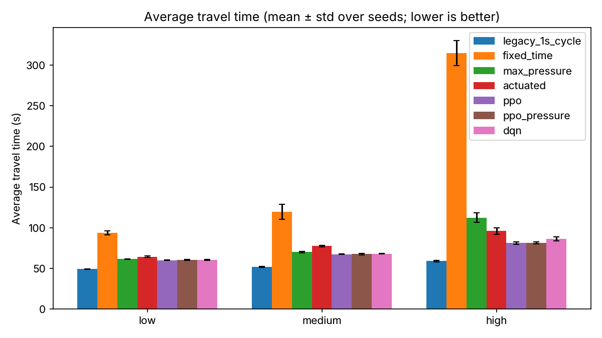
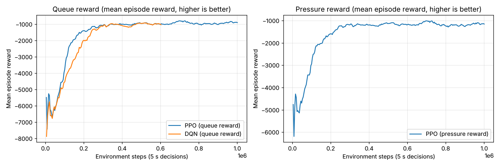

# Traffic Signal Control with Reinforcement Learning: Revisited

This report follows up the CS 175 class project ([original report](Final%20Project%20Report.pdf)). The class project trained PPO agents in CityFlow but couldn't show a clear improvement over a baseline. This follow-up fixes the simulation setup and the evaluation, then retrains the agents. Under realistic signal timing, they now beat every realistic controller tested, including the detector-based "actuated" control that real intersections use.

## 1. What was wrong with the original setup

| Problem | Effect | Fix |
|---|---|---|
| An agent was created for all 8 intersections, but 6 are virtual entry/exit points with no traffic light | 6 of 8 policies controlled nothing and added noise | Agents only on the 2 signalised intersections |
| Observations mixed outgoing roads with incoming ones and assumed 3 lanes per road | Agents saw queues that their light doesn't control | Observe only incoming lanes, using each road's real lane count |
| The baseline changed phase every simulated second (including the clearance phase) | Not a real signal plan | Fixed-time, actuated and max-pressure baselines with real timing rules |
| Agents could also change phase every second | CityFlow has no yellow time or start-up loss, so rapid flicking is an unrealistic shortcut (see §3) | Agents decide every 5 s, with at least 10 s of green and a 5 s clearance on every change |
| Results compared the agents' own reward curves | Reward isn't a traffic outcome, and the two controllers weren't measured the same way | Every controller is measured on average travel time, queue length, throughput and completion rate |
| One deterministic, heavily oversaturated traffic file with no turning traffic | Every controller gridlocks, so the comparison says little | Random (Poisson) arrivals with turning traffic at low, medium and high demand. Training and evaluation use disjoint seeds |
| Code only ran from `scripts/`, with no reproducible install | Shaky setup | Repo-root-relative paths, pinned dependencies, a Dockerfile that builds CityFlow, and tests |

## 2. Setup

**Network.** CityFlow's 1×2 grid: two signalised intersections, 300 m roads, and 3 lanes per approach (left, straight, right). Each intersection has 8 green phases plus a clearance phase.

**Traffic** (`scripts/scenarios.py`). Arrivals on each of the 6 entry roads follow a Poisson process. Low demand is 180 vehicles/hour per approach, medium is 360 and high is 540. Vehicles turn left 15% of the time, go straight 70% and turn right 15%. Episodes last 1 hour of simulated time. Training uses seeds 1000–1049, and evaluation uses seeds 0–4.

**Baselines** (`scripts/controllers.py`). All of them use a 5 s clearance on every change.
- *Fixed-time*: a 4-phase cycle with 30 s greens. 30 s was the best of 10, 15, 20 and 30 s.
- *Actuated*: how detector-equipped signals run in practice, following the [FHWA Signal Timing Manual](https://ops-dr.fhwa.dot.gov/Publications/signal_timing/04.htm).
  - Stop-line detectors cover the last 30 m of each lane. Real signals use inductive loops, or video or radar; they don't weigh vehicles.
  - Each green lasts at least 10 s and is extended while vehicles keep arriving. It ends once no vehicle has been detected for 3 s (gap-out), or at 40 s if another phase is waiting (max-out).
  - Phases with no waiting vehicles are skipped.
- *Max-pressure* (Varaiya 2013): every 10 s it picks the phase with the largest difference between upstream and downstream vehicle counts. It is a research benchmark that needs per-lane counts.

**RL agents** (`scripts/signal_env.py`, `train_ppo.py`, `train_dqn.py`).
- *Timing*: an agent decides every 5 s which of the 8 green phases to show. Changes are only allowed after 10 s of green and always go through the 5 s clearance.
- *Observation*: vehicle and waiting counts on each incoming lane, the current phase, and "can switch" / "in clearance" flags.
- *Reward*: minus the number of waiting vehicles on the intersection's incoming lanes (the "queue" reward). A "pressure" reward was also tested.
- *Policy*: one policy is shared by both intersections, with no centralized critic.
- *PPO*: RLlib, 1M environment steps, about 27 minutes on 4 CPU cores.
- *DQN*: RLlib, with double Q-learning, a dueling network, 3-step returns and prioritized replay. It trained for 600k steps, about 44 minutes.

## 3. Results

Average travel time in seconds (lower is better), as mean ± std over 5 evaluation seeds that no agent saw in training. The full table, with queue length, throughput and completion rate, is in [`results/evaluation/summary.md`](../results/evaluation/summary.md).

| Controller | Low | Medium | High | Original flow file |
|---|---|---|---|---|
| Fixed-time | 93.7 ± 2.4 | 119.6 ± 9.0 | 314.5 ± 15.3 | 1426 |
| Actuated | 64.5 ± 0.9 | 77.7 ± 0.9 | 96.0 ± 3.9 | 1027 |
| Max-pressure | 61.5 ± 0.3 | 70.2 ± 0.9 | 112.5 ± 6.1 | 1072 |
| **PPO** (queue reward) | **60.2 ± 0.6** | **67.5 ± 0.5** | **81.3 ± 1.5** | **938** |
| PPO (pressure reward) | 60.4 ± 0.5 | 67.7 ± 0.8 | 81.5 ± 1.1 | 1264 |
| DQN (queue reward) | 60.6 ± 0.7 | 68.1 ± 0.4 | 86.3 ± 2.6 | 1018 |
| *Legacy: change phase every 1 s* | *49.3 ± 0.3* | *52.0 ± 0.4* | *59.1 ± 0.8* | *1345* |





### Findings

1. **RL beats every realistic controller, and the gap grows with demand. A second training run of PPO reproduced this almost exactly.** At high demand, PPO's average travel time is 15% lower than actuated control (81 s vs 96 s) and 28% lower than max-pressure. Its average queue is also about a third smaller (12.9 vs 19.8 vehicles). At low demand every adaptive controller performs about the same, and PPO's lead over max-pressure is 1.3 s.
2. **Actuated control is the baseline to beat, and the fixed timer is not.** A detector-based signal cuts average travel time by 31% (low) to 69% (high) compared with the fixed timer. It also beats max-pressure at high demand, where max-pressure re-decides every 10 s and switches too often. Comparing RL only against a fixed timer, as the class project did, overstates what RL adds.
3. **The algorithm matters less than getting the environment right.** PPO and DQN end up within about 1% of each other at low and medium demand. PPO is ahead at high demand (81 s vs 86 s) and learned with fewer samples (see the training curves). The changes that made the difference were the timing rules, the observations and the evaluation design, not the choice of algorithm.
4. **The two rewards perform the same on familiar traffic but generalize differently.** The queue and pressure rewards give the same results on the randomized scenarios. On the original flow file, which has no turning traffic and much higher demand than anything seen in training, the queue-reward agent is the best controller tested (938 s), while the pressure-reward agent falls behind actuated and max-pressure (1264 s). A single out-of-distribution scenario is weak evidence, but it suggests the queue reward is the safer default.
5. **The simulator's switching loophole can make any controller look good.** CityFlow charges nothing for switching, so changing phase every second gives the best travel times of all (the italic row). Cycling the four main phases every 3 s instead gives over 400 s at medium demand. The class project's agents could exploit this loophole, so any RL result without minimum green and clearance times should be treated with suspicion.
6. **A default hyperparameter nearly sank the result.** The first PPO run did worse than the fixed timer because RLlib's default `vf_clip_param=10` is far smaller than these returns, so the value function never learned. Raising it to 1e4 and using a discount of 0.95 per 5 s decision (looking about 100 s ahead) fixed it.

## 4. Limitations and next steps

- **Small network.** Two intersections can't show coordination effects such as green waves or spillback between many junctions. The next step is a larger grid (for example 3×3 or 4×4), adding neighbour information to the observations or a centralized critic (true MAPPO).
- **Simplified traffic.** Arrivals are synthetic and stationary within an episode. There are no time-of-day peaks, pedestrians or detector errors. Real traffic counts would be a stronger test.
- **The simulator is optimistic.** CityFlow has no yellow phase or start-up loss. The 5 s clearance stands in for both, but absolute travel times shouldn't be compared directly with field data.
- **Few training runs.** A second PPO training run (seed 1, not committed) scored within 0.2 s of the committed agent at low, medium and high demand (60.1, 67.4 and 81.3 s) and within 1% on the original flow file (932 s), so the PPO result looks stable. DQN and the pressure-reward PPO were trained once each.
- **Baseline tuning was limited.** The fixed-time greens, the actuated passage time and maximum green, and max-pressure's interval were each tuned only over a small grid. A better-tuned max-pressure, with a longer interval at high demand, would narrow the gap there.

## Reproducing

```bash
docker build -t traffic-rl . && docker run --rm -it traffic-rl bash
pytest -q tests
python scripts/train_ppo.py --iterations 250                 # models/ppo_timed
python scripts/train_ppo.py --iterations 250 --reward pressure --out models/ppo_pressure
python scripts/train_dqn.py --timesteps 600000               # models/dqn_timed
python scripts/evaluate.py --policy ppo=models/ppo_timed ppo_pressure=models/ppo_pressure dqn=models/dqn_timed
python scripts/plot_training.py
```
